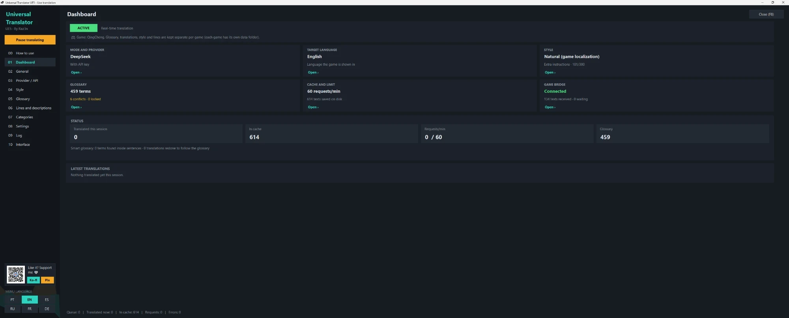
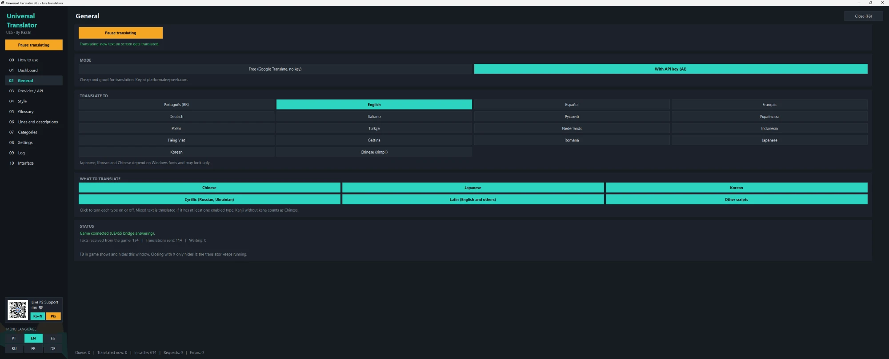
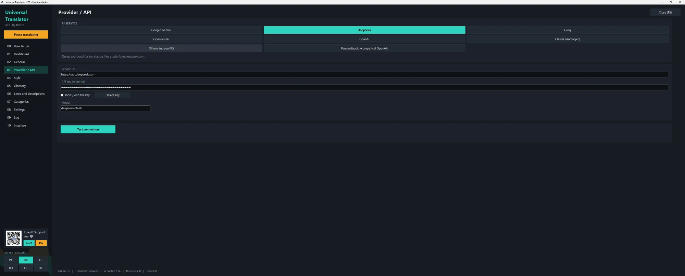
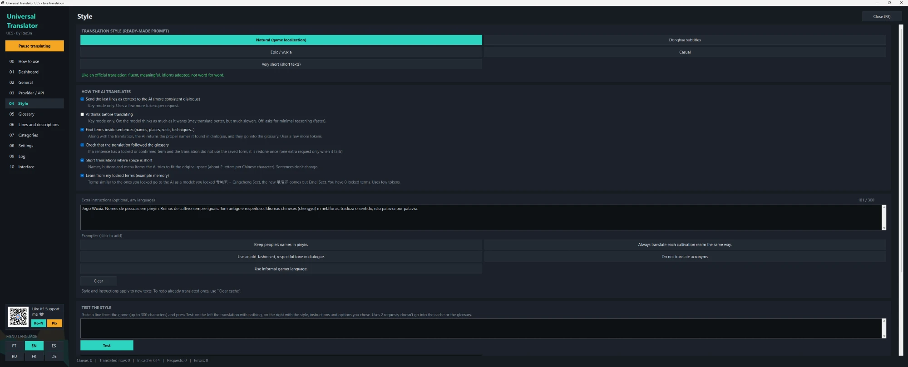
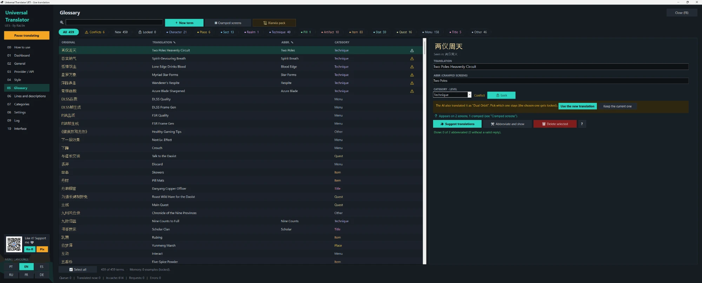
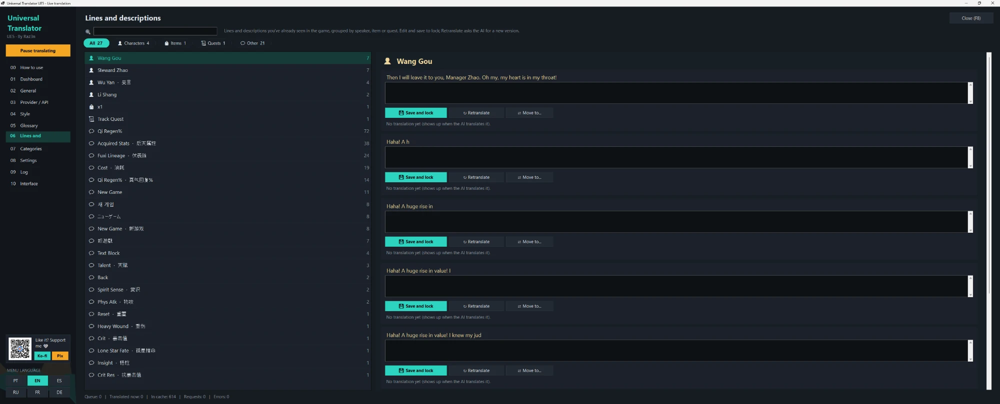
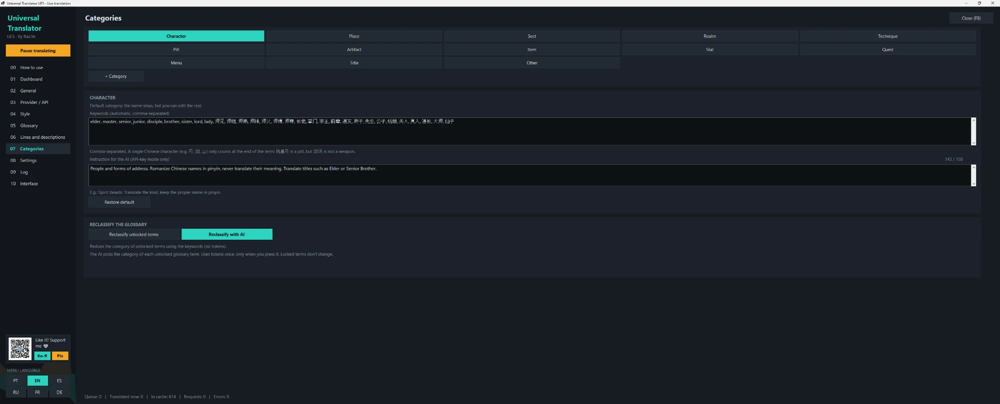
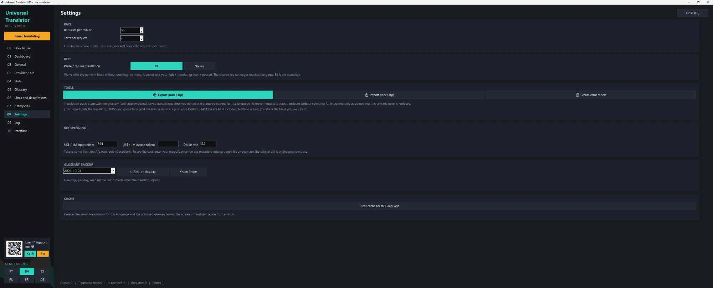
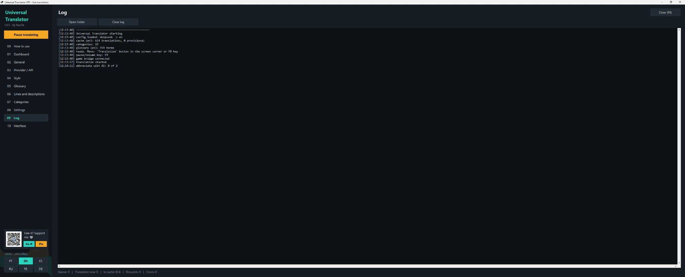
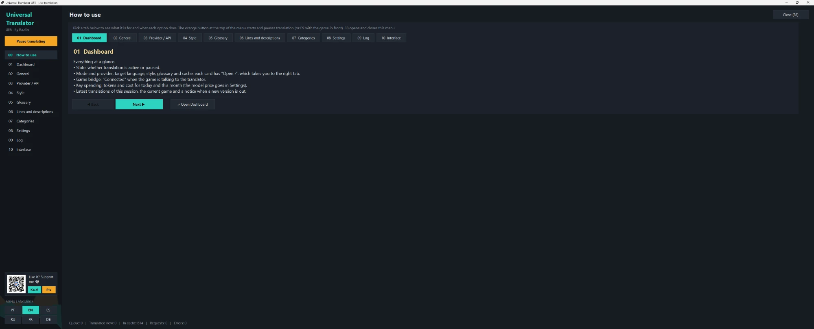

# Tradutor UE5

Tradução em tempo real para jogos em Unreal Engine 5, portada do
[ModLive](https://github.com/Raz3n28/ModLive-Traducao-Universal) (Unity). Primeiro alvo:
**Sanctum: Whispers of Qingcheng** (下一站青城).

## Instalação / How to install

**Requisitos / Requirements:** Windows 10/11 x64 · [.NET 8 Desktop Runtime (x64)](https://dotnet.microsoft.com/download/dotnet/8.0) · [UE4SS experimental](https://github.com/UE4SS-RE/RE-UE4SS/releases)

1. **Instale o .NET 8 Desktop Runtime (x64)** no link acima ("Desktop Runtime", "Windows x64").
   Para conferir, no cmd: `dotnet --list-runtimes` deve mostrar `Microsoft.WindowsDesktop.App 8.x`.
2. **Instale o UE4SS** (versão experimental mais recente): extraia o zip dele na pasta do executável do jogo.
   No Sanctum: `...\steamapps\common\QingChengDemo\QingCheng\Binaries\Win64\` (onde fica o
   `QingCheng-Win64-Shipping.exe`). Ali devem ficar o `dwmapi.dll` e a pasta `ue4ss`.
3. **Sanctum (UE 5.8):** em `ue4ss\UE4SS-settings.ini`, seção `[Hooks]`, deixe só `HookLoadMap = 1` e
   `HookEngineTick = 1`; todos os outros `Hook... = 0`. Sem isso o jogo pode travar ou fechar.
4. **Baixe o TradutorUE5.zip** em [Releases](https://github.com/Raz3n28/Tradutor-UE5/releases) e copie a pasta `ue4ss` do zip para a mesma `Binaries\Win64`
   (ela se junta com a do UE4SS).
5. **Abra o jogo.** O tradutor abre sozinho. Aperte **F8** para abrir o menu, escolha o idioma e o serviço
   (grátis ou com chave) e clique em **Começar tradução**. **F9** pausa/continua.

Para desinstalar, apague `ue4ss\Mods\TradutorUE5` (ou o `dwmapi.dll` para tirar o UE4SS inteiro).
Detalhes e solução de problemas: [`LEIA-ME.txt`](LEIA-ME.txt).

<details><summary><b>English</b></summary>

1. Install the **.NET 8 Desktop Runtime (x64)** (link above).
2. Install **UE4SS** (latest experimental): extract it next to the game's `*-Win64-Shipping.exe`
   (Sanctum: `QingCheng\Binaries\Win64`). You should see `dwmapi.dll` and a `ue4ss` folder there.
3. **Sanctum (UE 5.8):** in `ue4ss\UE4SS-settings.ini`, `[Hooks]` section, keep only `HookLoadMap = 1` and
   `HookEngineTick = 1`; set every other `Hook...` to `0`, otherwise the game may freeze or crash.
4. Download **TradutorUE5.zip** from [Releases](https://github.com/Raz3n28/Tradutor-UE5/releases) and copy its `ue4ss` folder into the same `Binaries\Win64` folder.
5. Start the game. The translator opens by itself. Press **F8** for the menu, pick the language and service
   (free or API key) and click **Start translating**. **F9** pauses/resumes.

To uninstall, delete `ue4ss\Mods\TradutorUE5`.
</details>

## Screenshots

**Painel / Dashboard** – estado, provedor, idioma, glossário, cache e gasto da chave num lugar só.


**Geral / General** – modo grátis (Google) ou com chave de IA, 18 idiomas de destino e quais escritas traduzir.


**Provedor / Provider** – Gemini, DeepSeek, Groq, OpenRouter, OpenAI, Claude, Ollama ou personalizado.


**Estilo / Style** – estilos prontos (natural, donghua, épico/wuxia, casual, bem curto), instruções extras e teste do estilo.


**Glossário / Glossary** – nomes, técnicas e itens com categoria, abreviação, trava, conflitos e sugestões da IA.


**Falas e descrições / Lines and descriptions** – falas agrupadas por personagem, item ou missão: editar, travar e retraduzir.


**Categorias / Categories** – 13 categorias de cultivo com palavras-chave e instrução para a IA.


**Configurações / Settings** – ritmo, tecla F9, pacote de tradução (.zip), relatório de erro, gasto, backup e cache.


**Log** – o que o tradutor está fazendo.


**Como usar / How to use** – guia de cada aba dentro do próprio menu (F8).


## Como funciona

```
jogo (UE5) ── UE4SS ── ponte Lua ──(arquivos em troca/)── TradutorCerebro.exe ── Google / IA
```

- **Ponte** (`ponte/TradutorUE5/Scripts/main.lua`): mod Lua do UE4SS. Olha os `TextBlock` e
  `RichTextBlock` da tela, manda texto novo para o cérebro e troca pela tradução. F8 abre o menu.
- **Cérebro** (`cerebro/`): .exe em C# (.NET 8, WinForms). Reaproveita Cache, Glossário, Categorias,
  Json, Motor e Provedores do ModLive (UnityWebRequest virou HttpClient). A janela dele é o menu.
- **Troca**: `pedidos.txt` (ponte → cérebro) e `respostas.txt` (cérebro → ponte). Formato em
  `cerebro/Ponte.cs`.

## Build

O GitHub Actions compila a cada push e gera o artefato **TradutorUE5** (zip pronto para copiar em
`Binaries\Win64`). Veja `LEIA-ME.txt` para instalar.

## Direitos autorais

© 2026 Raz3n. Todos os direitos reservados. Uso pessoal liberado; redistribuir, vender ou publicar
versões modificadas só com autorização. Veja [`LICENSE`](LICENSE).

© 2026 Raz3n. All rights reserved. Free for personal use; redistribution, selling or publishing
modified versions requires permission. See [`LICENSE`](LICENSE).
